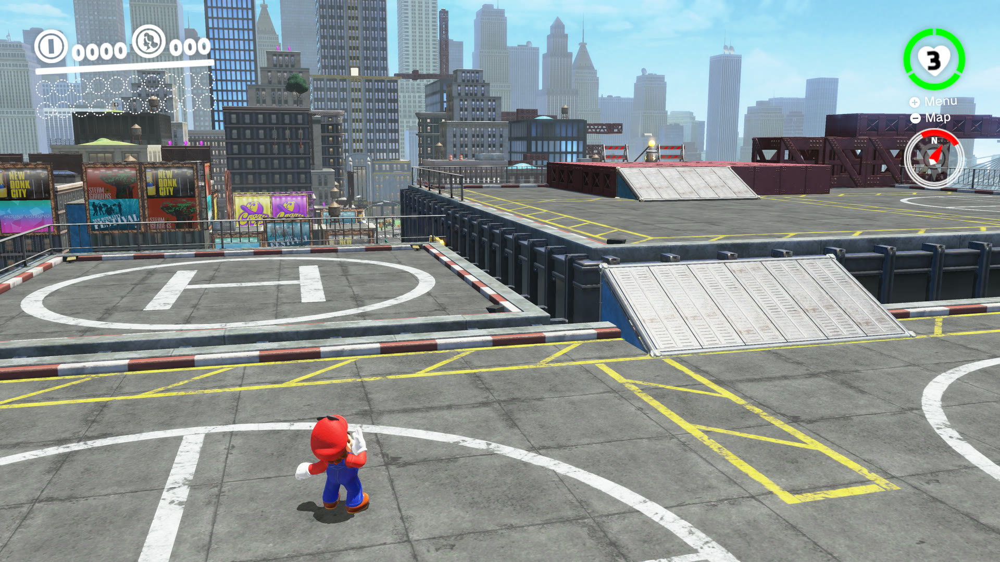
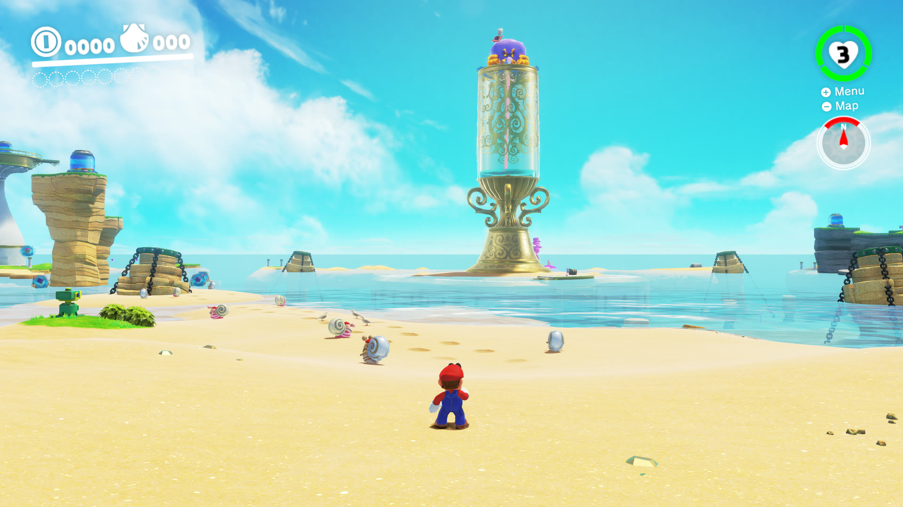
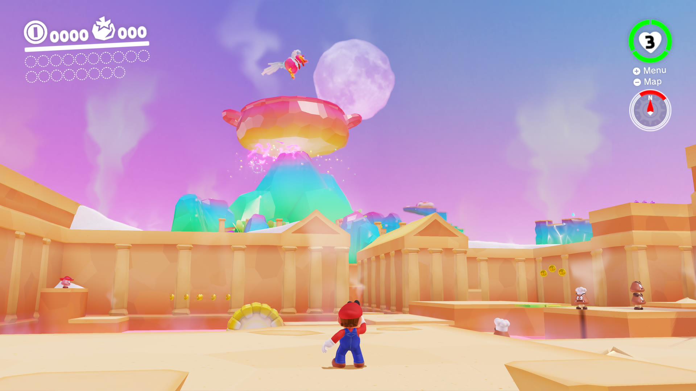
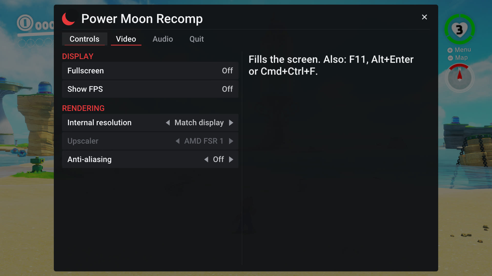

# Power Moon Recomp — AMD K10 fork

*Super Mario Odyssey* running natively on **AMD K10 processors** (Phenom II X4/X6, Athlon II) under Linux.

[Power Moon Recomp](https://gitlab.com/zzzarathustra-dev/power-moon-recomp) by zzzarathustra-dev turns the Switch
game's ARM64 code into C ahead of time and compiles it into a regular PC program, with the Switch's system parts
(kernel, services, the NVN graphics API, audio) reimplemented on Vulkan. Its game code needs **AVX2, FMA and BMI2**
(Intel Haswell / AMD Zen or newer) and the program refuses older CPUs. AMD's K10 chips from 2008-2011 lack those, and
also SSSE3, SSE4.1 and SSE4.2, so they can't run it at all.

This fork adds a game code target for them, keeps the result bit-exact with the original's floating point, checks that
no instruction a K10 lacks gets into what runs on the player's machine, and documents what limits a Phenom II in this
game and how far it goes.

> [!IMPORTANT]
> **You need your own copy of the game**, version **1.0.0** (no updates), dumped from your own console as `exefs` and
> `romfs`. Nothing of the game is in this repository or its releases. Instructions on dumping are not provided.

> [!NOTE]
> Linux only (x86-64). On Windows or macOS, or on a CPU with AVX2, use the
> [original project](https://gitlab.com/zzzarathustra-dev/power-moon-recomp): it gets updates first. Like the original,
> this fork was made with an AI coding agent (Claude, through Claude Code), directed and tested on real hardware by a
> human.

## Results on a Phenom II

Phenom II X6 1100T (K10, 6 cores, 3.3 GHz, NB at 2.8 GHz), Radeon RX 580, 28 GB DDR3, Void Linux, kernel 7.3 (RADV).
Same spot of the game, frame rates over 2-second windows from the game's own log:

| | Stock kernel | Kernel with the amdgpu patch (see [Performance](#performance-on-a-phenom-ii)) |
|---|---|---|
| Frame rate | 37-45 fps | **60 fps** (the game's cap) |
| Worst frame | 25-29 ms | 17-18 ms |
| Render thread | 25% in the program, **68% in the kernel driver** | 55% in the program, 2% in the kernel |
| GPU busy | ~29% | ~60% |

With the stock kernel the game is playable at 37-45 fps in busy areas and 60 in lighter ones. The first start builds
the game code for the CPU, which takes much longer on a Phenom II than the few minutes on a current PC (on a Ryzen 7
7735HS it took 20 minutes; on the Phenom it wasn't timed: the code built on the Ryzen for K10 was copied over).

## Play

1. Download `Power Moon Recomp-0.2.1-k10-linux-x86_64.AppImage` from this fork's
   [Releases](https://github.com/deadlynch/power-moon-recomp-k10/releases) (a pre-release).
2. `chmod +x` it and start it. The first time, choose the folder with your game files (`exefs` and `romfs`). Setup
   checks the version, copies what the game needs into `~/.local/share/power-moon-recomp` (about 6 GB) and builds the
   game code on your PC for its CPU: for a K10 the log says `target: compatible (-march=amdfam10, no FMA instructions:
   slower)`. Then the game starts; later starts go straight to it.
3. The in-game menu: **F1** or **Esc** (controller: Home / Guide). Details on the AppImage:
   [docs/linux.md](docs/linux.md).

Needs: glibc 2.35 or newer, a Vulkan 1.3 driver (Mesa RADV on the RX 580 here), 8 GB RAM (16 recommended), about 7 GB
free disk space.

## What this fork changes

Everything not listed here is the original project, unchanged.

1. **A second game code target, picked from the CPU.** The original builds the game code for `x86-64-v3` only. Here
   Linux x86-64 has a compatible target, `-march=amdfam10` (SSE3, SSE4a, POPCNT, LZCNT; no SSSE3, SSE4 or FMA), with
   an id of its own, so a library built for one kind of CPU is never loaded on the other. The setup page and the loader
   pick it when the CPU lacks AVX2, FMA or BMI2 (`runtime/gamelib.c` `gamelib_compat`, `runtime/gamebuild.c`); CPUs
   with AVX2 get the original build. `ODYSSEY_COMPAT_CPU=1` forces the K10 target on any CPU that runs it, to compare
   the two. The startup check names what a CPU too old for both lacks. The scheme comes from
   [Savage Wind Recomp](https://github.com/Revivedx/SavageWindRecomp) (MIT).
2. **Fused multiply-add without FMA instructions.** The Switch's FMADD family rounds once; a separate multiply and add
   would round twice and drift from the console. `runtime/simd_softfma.h`, from Savage Wind Recomp (MIT, Igorms27's
   work), does it in integer arithmetic and follows the thread's MXCSR (rounding mode, FTZ, DAZ) like the FMA
   instructions. glibc's own fallback is a few ulp off with FTZ/DAZ and costs ~400 cycles a call.
3. **Rounding without SSE4.1.** Without `ROUND*` instructions clang turns every lane of rint/ceil/floor/trunc/round
   into a libm call, and FRINT* / FCVT* use them on every conversion. `runtime/simd_fp.h` rounds inline with SSE2
   arithmetic on such targets.
4. **No instruction above K10 gets through.** `tools/check_isa.py` (from TotK PC Recomp, MIT) disassembles objects,
   libraries and executables and refuses SSSE3/SSE4/AVX/BMI instructions outside functions that check the CPU first.
   `tools/linux/package.sh` runs it over the app and shaderc in every AppImage, and lists what SDL3, FFmpeg, zig and
   the frozen generator hold (they choose their SIMD code by CPUID at run time).
5. **Linux test fixes.** `tools/test_simd.py` and its harness didn't build on Linux (an outdated `fnprof_hit`
   signature, libm left out of the link).
6. The version is `0.2.1-k10`, which also names the AppImage.

## How it was checked

- `tools/test_simd.py --cflags=-march=amdfam10`: the FP/SIMD lowering of 40,000 encodings, 959,784 cases against
  Unicorn (Cortex-A57): none failing. The default `x86-64-v3` target too.
- `tools/test_softfma.c`: 50 million cases, every rounding mode with and without FTZ / DAZ, bit for bit against the FMA
  instructions.
- The player's path on a Ryzen with the K10 target forced: the setup generated and built the game code with the
  bundled zig for `amdfam10` (20 minutes there), `check_isa` found nothing above K10 in the library, and the game ran at
  60 fps.
- The AppImage built in the original's Ubuntu 22.04 container: the app and shaderc are clean for K10.
- On the Phenom II: the game code built for K10 loads, the game plays (results above).

## Performance on a Phenom II

What limits the frame rate here, found with the game's render profiler (`ODYSSEY_VK_PROF=1`) and `perf`:

- **Not the game code and not the soft FMA.** The game's main thread runs at about half a core; the soft FMA is ~10% of
  it.
- **The render thread** (the game's GPU command lists translated to Vulkan, `runtime/nvn/rqueue.c`) is the busy one,
  and with the stock kernel it spent **~68% of its time inside the kernel**, in `vkQueueSubmit`: `amdgpu_cs_parser_bos`
  27%, `hmm_vma_walk_pmd` 25%, `prep_new_page` 11%.
- **Why:** shaders read and write the game's memory directly, so the program imports the whole 3.2 GB guest heap into
  the GPU (`VK_EXT_external_memory_host`, `runtime/nvn/vulkan/exec.c` `gmem_import`). For such a "userptr" buffer the
  amdgpu kernel driver faults in and compares every one of its ~800,000 pages on **every** submission, about twice a
  frame. A current CPU hides that; a Phenom II can't. Turning the import off (`ODYSSEY_VK_NO_GMEM=1`) gave 53-60 fps
  but broke effects (small glitches and flicker), so it's no fix.

**[phenom-kernel-patches](https://github.com/deadlynch/phenom-kernel-patches)** has a kernel patch and a script that
builds and installs it for the running kernel: the driver skips the walk while the kernel has seen no change to the
buffer's pages. That gives the 60 fps above. **Read its caveats first:** the same change was rejected upstream by the
amdgpu maintainer because it weakens a security check, so it is only for a single-user gaming PC, by choice, and not
something this fork needs or ships. TotK Recomp and Savage Wind Recomp import host memory too and may gain from it as
well.

## Sister projects

- [TotK Recomp — AMD K10 fork](https://github.com/deadlynch/totk-pc-recomp-k10) (*Tears of the Kingdom*)
- [Savage Wind Recomp — AMD K10 fork](https://github.com/deadlynch/SavageWindRecomp-K10) (*Breath of the Wild*)

## Thanks

To **zzzarathustra-dev** for Power Moon Recomp, to **Peiikai** and the contributors of
[LAS Recomp](https://github.com/peiikai/LASRecomp), which it is built on, and to **Revivedx**, **Igorms27** and the
Savage Wind Recomp contributors for the compatible target and the soft FMA this fork builds on.

---

## About the game in this port

Everything below comes from the original project and applies here unchanged.

  
  

  
  

Screenshots of the Windows version, game rendered at 4K. <i>Super Mario Odyssey</i> &copy; Nintendo.

### Status

Playable from start to finish: the whole game has been played through without problems - every kingdom, the bosses,
the 2D and 8-bit sections, the ending and the post-game - at 60 fps on a current desktop PC (by the original's author).

Known issues:
- The first time an area appears, its shaders are compiled by the graphics driver. Shaders are compiled ahead, while
  the game loads, and side by side, but a stage you enter for the first time can still take a second or two to
  appear, and a new effect can hold the picture for a moment (the game and its sound keep running). Everything is
  cached afterwards (`cache/`): a second visit starts in a fraction of a second. Shaders the game has loaded but not
  shown yet are prepared at the next start, like emulators do: a small "Preparing shaders" window can appear for a few
  seconds before the game opens.
- Only version 1.0.0 of the game runs (no updates).
- The game runs at 60 fps, as on the Switch: its logic is tied to the frame rate (a higher rate would play faster).
  On 120 Hz+ displays, *Frame interpolation* (Video) shows 120 images per second; it adds about half a frame of latency.

### Controls

The in-game menu: **F1** or **Esc** (controller: Home / Guide button) - video, audio, controls (rebinding), language.

| Switch | Keyboard | Controller |
|---|---|---|
| Left stick | W A S D | left stick |
| Right stick (camera) | Num 8 / 4 / 5 / 6 | right stick |
| A / B / X / Y | K / J / L / I | by position (east = A, south = B) |
| L / R, ZL / ZR | Q / E, 1 / 3 | shoulder buttons / triggers |
| + / - | Enter / Backspace | Start / Back |
| Stick clicks | F / Num 0 | stick clicks |
| D-pad | arrow keys | d-pad |

Fullscreen: F11 or Alt+Enter.

### Files

Everything lives in one folder: on Windows the program's folder (a source checkout: the folder
`build\PowerMoonRecomp.exe` sits in, or its parent when that has `extracted\`), on Linux
`~/.local/share/power-moon-recomp`, on macOS `~/Library/Application Support/io.github.powermoonrecomp`:

- `extracted\` - your game files as setup made them (`exefs\`, `romfs.bin`) and the game code built from them
  (`odyssey_game.dll`)
- `save\` - your saves, `cache\` - compiled shaders, `powermoon.ini` - settings, `PowerMoonRecomp.log` - the log
- `mods\` - optional mods, each in a folder of its own (see below)
- `fonts\` - optional: the Switch's system fonts from your console (see `fonts\README.md`)

### Mods

Mods that replace or add game files work: costumes, models, textures, music, text, levels - RomFS mods, as made for
the Switch emulators. Put each mod in its own folder in `mods\` (in the folder above), with its `romfs` folder inside,
just as it comes: `mods\<Mod name>\romfs\ObjectData\...`. The Atmosphere layout
(`...\atmosphere\contents\0100000000010000\romfs\`) works too. The game's own files stay untouched.

In the menu (**F1**), the **Mods** tab lists them: switch each one on or off, or open the mods folder; changes apply the
next time the game starts. If two mods change the same file, the one higher in the list wins (the folder names in
alphabetical order).

Mods made for version 1.0.0 work best; ones made for later versions of the game may not. Code mods (exefs: IPS /
pchtxt patches, or code like Super Mario Odyssey: Online) can't be used - the game code is recompiled from the
original on your PC - and show up greyed out.

### How it works

- `tools/` - the recompiler (Python): `gen.py` lifts every function of the game's NSO modules to C (`lifter.py`),
  `odyssey_patches.py` holds the few game-specific instruction patches.
- `runtime/` - the program: module loader, a small Horizon kernel (threads, synchronization, memory; threads of one
  Switch core take turns as there), IPC services (file system, audio renderer, input, time, ...), HLE of SDK
  functions, the NVN graphics API on Vulkan with a Maxwell shader translator (`runtime/nvn`), movie playback with
  FFmpeg, the in-game menu (Dear ImGui), the first-start setup (`runtime/ui/setup.mm`, `runtime/gamebuild.c`).
- Debugging tools are environment variables (`ODYSSEY_*`), documented where they are read.

A release is made with `make deps-windows` (an LGPL-only FFmpeg), `make gen-helper` (the generator as a standalone
program), `tools/fetch_zig.sh` (the compiler setup uses on the player's PC) and `make dist` - the zip holds no game code.

### Credits

- **[LAS Recomp](https://github.com/peiikai/LASRecomp)** by Peiikai and its contributors - the static recompiler,
  runtime and renderer this port is built on, and the frame interpolation (MIT license). Huge thanks: without it this
  port wouldn't exist.
- **[OdysseyDecomp](https://github.com/MonsterDruide1/OdysseyDecomp)** - names and structure of the game's code, used
  for reading and debugging (no code from it is in this repository)
- [Switchbrew](https://switchbrew.org) and [envytools](https://github.com/envytools/envytools) - documentation of the
  Switch's system interfaces and the Maxwell GPU
- An MIT-licensed open-source project's audio renderer and shader instruction decoders (license and copyright notice:
  `third_party/ryujinx/LICENSE.txt`) - the audio effects follow its code, its decoders were the bit-layout reference
  for parts of the shader translator
- Libraries: [SDL 3](https://libsdl.org) (zlib), [FFmpeg](https://ffmpeg.org) (LGPL, linked dynamically),
  [Dear ImGui](https://github.com/ocornut/imgui) (MIT), [Vulkan Memory Allocator](https://github.com/GPUOpen-LibrariesAndSDKs/VulkanMemoryAllocator) (MIT),
  [shaderc](https://github.com/google/shaderc) (Apache 2.0), [SMAA](https://github.com/iryoku/smaa) (MIT,
  `third_party/smaa/LICENSE.txt`), [AMD FSR 1](https://github.com/GPUOpen-Effects/FidelityFX-FSR) (MIT,
  `third_party/fsr/LICENSE.txt`),
  the [Roboto](https://github.com/googlefonts/roboto) font of the menu (Apache 2.0, from Dear ImGui's
  `third_party/imgui/misc/fonts`)
- In the release, to build the game code on your PC: [Zig](https://ziglang.org) (MIT) with its
  [LLVM / Clang / LLD](https://llvm.org) (Apache 2.0 with LLVM exception) and MinGW-w64 headers; the generator runs on
  [Python](https://www.python.org) (PSF license), frozen with [PyInstaller](https://pyinstaller.org) (GPL with
  bootloader exception), with [Capstone](https://www.capstone-engine.org) (BSD), [Unicorn](https://www.unicorn-engine.org)
  (GPL 2.0) and [LZ4](https://github.com/python-lz4/python-lz4) (BSD). Their sources are at those links; the release
  carries every licence in `licenses/` (with `licenses/README.txt`).

## Legal

This is a fan project. It is not affiliated with, endorsed by or sponsored by Nintendo. *Super Mario Odyssey* is a
trademark of Nintendo. No game files, game code, assets or fonts are included in this repository or its releases, and
nothing built from your game files (`extracted/`, `generated/`, `odyssey_game.dll`) may be shared. You must provide
your own legally obtained copy of the game.

## License

The code of this repository is under the [MIT License](LICENSE) (it keeps LAS Recomp's copyright notice; the fork's
additions from Savage Wind Recomp and TotK PC Recomp are MIT too and keep their notices). Third-party
components keep their own licenses (above, and in `third_party/`). The license covers this project's code only - it
grants nothing for Nintendo's game.
